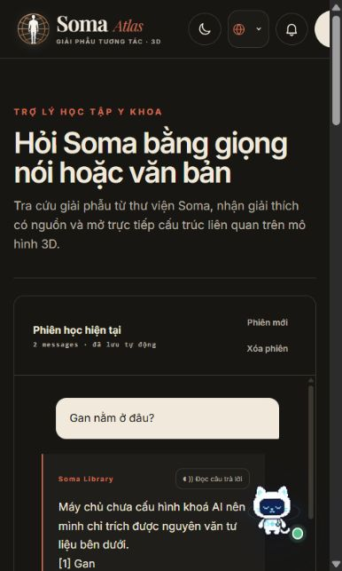

# Rà soát và refactor — 11/10/2026

## Phạm vi

Rà soát frontend `Soma_Fe`, API `soma_be` và trang quản trị `Soma_Bo`.
Giữ nguyên các thay đổi có sẵn trong workspace; chưa commit hoặc merge.

## Các vấn đề đã sửa

- Chuẩn hóa HTTP client ở frontend và trang quản trị: hỗ trợ `Headers`, tuple headers, multipart upload, hủy request và lỗi JSON `null`. Tài liệu cá nhân dùng chung cơ chế xử lý phiên.
- Phiên đăng nhập vẫn hoạt động trong tab khi localStorage bị chặn hoặc hết quota. Phản hồi 401 của request cũ không xóa phiên đăng nhập mới; lỗi mạng không tự đăng xuất. Kết quả tải hồ sơ cũ không ghi đè trạng thái tài khoản mới.
- Tách kiểm tra JSON thành `requestBody.ts`; loại bỏ việc ép object/array thành câu hỏi. Các route trả 400 với dữ liệu sai cấu trúc; các route yêu cầu tài khoản kiểm tra quyền trước khi xử lý nội dung.
- Refactor state chat và lịch sử phiên. Chỉ lưu sau khi nạp dữ liệu; hủy request khi đổi/xóa phiên; không đưa câu trả lời cũ vào phiên mới. Side effect lưu trữ được tách khỏi state updater.
- Đổi mật khẩu và reset mật khẩu chạy trong transaction. Reset token được nhận bằng update có điều kiện, ngăn hai request cùng dùng một token. Sai mật khẩu hiện tại trả 400 để tránh xóa nhầm phiên còn hợp lệ. Các thao tác tài khoản kiểm tra trạng thái vô hiệu hóa.
- Login throttle chỉ tính lỗi xác thực, xử lý đúng thời điểm hết hạn và giới hạn số khóa trong bộ nhớ.
- Nguồn tra cứu phân biệt tên “Gan” và “Gân”, dùng tên giữ dấu để tránh gộp hai cấu trúc. Câu hỏi về người không kéo theo tài liệu thú y; câu hỏi về động vật giữ phạm vi thú y; câu hỏi so sánh vẫn lấy cả hai. Câu hỏi gốc giữ phạm vi khi hợp nhất truy vấn AI viết lại.
- Tái sinh dữ liệu học Atlas để sửa 27 liên kết cũ không còn thuộc scene hiện tại. Kiểm tra lại 2.234 mesh và 5.709 ghi chú liên quan. Thêm lệnh `test:atlas` để phát hiện lệch dữ liệu sau này.
- Chuyển `middleware.ts` sang `proxy.ts` theo Next.js 16. Sửa hooks, callback tự tham chiếu, ảnh thumbnail và link nội bộ; bỏ state/callback không sử dụng trong vòng lặp cử chỉ.
- Sửa phạm vi ESLint để bỏ cache build và checkout độc lập. Giữ kiểm tra trên mã nguồn thật; ngoại lệ CommonJS chỉ áp dụng cho `.cjs`.

## Kiểm chứng

| Phần | Kết quả |
| --- | --- |
| Frontend | ESLint, TypeScript, production build; 22/22 unit test |
| Backend | ESLint, Nest build; 54/54 test trong 9 suite |
| Trang quản trị | ESLint, TypeScript, production build; 7/7 test |
| HTTP local | 16/16 ca dữ liệu lỗi và route yêu cầu đăng nhập |
| Atlas | Framing, liên kết học liệu, lấy mẫu bề mặt và nhãn scene đạt |
| Cử chỉ / Vision / Voice / Wonder | Các bộ kiểm tra có sẵn đạt |
| Tài nguyên | Scene, model, lesion, quiz-bank, quiz-text và vet export đạt |
| Kho tri thức | Site KB và Vet KB đạt |
| Trình duyệt | Nhập/gửi câu hỏi, nhận nguồn trích dẫn; tạo phiên mới và tải lại |

Trên bản build cuối, câu hỏi “Gan nằm ở đâu?” có nguồn Gan đứng đầu;
không còn nguồn có tên chính xác “Gân” hoặc nguồn thú y. Console không ghi lỗi.
Các đoạn bổ sung vẫn có thể ít liên quan vì cơ chế tìm kiếm theo từ khóa.

Các kiểm tra frontend có thể chạy lại bằng `npm run lint`, `npx tsc --noEmit`,
`npm run test:unit`, `npm run test:atlas`, `npm run build`.
Để chạy `npm run test:api-boundary`, khởi động server local tại cổng 3100
hoặc đặt `SOMA_TEST_URL`. Các ca này đều bị chặn trước khi gọi AI hoặc ghi dữ liệu.

## Giới hạn kiểm chứng

Transaction được kiểm tra với Prisma mock; chưa thực hiện reset mật khẩu trên database thật.
Chưa kiểm chứng OAuth, SMTP và nhà cung cấp AI bằng tài khoản thật.
Cử chỉ/vision được kiểm tra bằng dữ liệu và script; chưa thử webcam/microphone vật lý
hoặc đo FPS trên GPU của máy người dùng. Chất lượng tìm kiếm vẫn phụ thuộc tư liệu và
heuristic; các test mới bảo vệ những lỗi cụ thể đã phát hiện.

Node phát cảnh báo `MODULE_TYPELESS_PACKAGE_JSON` khi chạy trực tiếp một số file
TypeScript. Các test vẫn đạt; không đổi module type toàn dự án chỉ để tắt cảnh báo.
